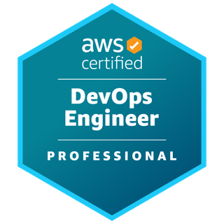
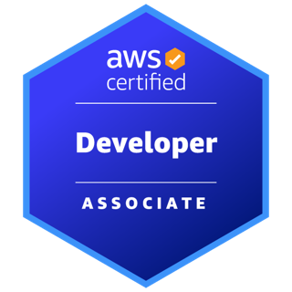
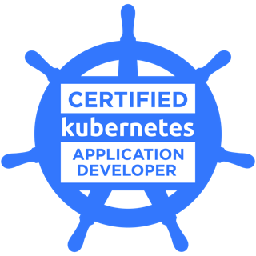
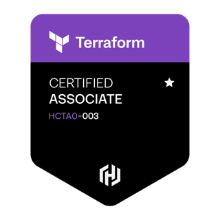

---
# the default layout is 'page'
order: 6
portrait: /assets/images/me/me-640.jpg
---
Hello there! 👋 I'm Sanket Vilas More, a Senior DevOps / Platform Engineer in Toronto with 15 years in software delivery, 10 of them building cloud infrastructure and CI/CD on AWS, Kubernetes (EKS, OpenShift) and Terraform. Across three enterprises I've cut non-production cloud spend by 30%, cut user-facing latency by 20% and removed most manual release work. I build AI agents with Claude Code, at work and in my own time.

> **Latest work:** at Roche I built an AI support agent with Claude Code. Grounded in product knowledge documents and wrapped in guardrails, it investigates a reported issue in the target environment, classifies it as an application or infrastructure problem, writes the root cause analysis and raises a pull request with the fix for the owning team. It drastically reduced ad hoc support requests from the development team.
{: .prompt-info }

## Experience

### Roche
**DevOps Infrastructure Engineer** · Toronto, ON · Nov 2024 to present

- Built scheduled shutdown of EKS worker nodes outside working hours with GitHub Actions and Karpenter, cutting compute cost by 30% across all 8 non-production environments.
- Built an AI support agent with Claude Code, grounded in product knowledge documents and wrapped in guardrails, that investigates a reported issue in the target environment, classifies it as an application or infrastructure problem, writes the root cause analysis and raises a pull request with the fix for the owning team. It drastically reduced ad hoc support requests from the development team and shortened the path from report to fix.
- Built Jenkins pipelines that deploy microservices to EKS and configure CloudFront, API Gateway and S3 static assets in one automated release.
- Provisioned and managed AWS infrastructure (VPC, RDS, IAM, S3, EC2, EKS) with Terraform across 13 environments (8 non-production and 5 production), keeping them consistent and repeatable.
- Implemented the Istio service mesh on EKS for secure, mutually authenticated service-to-service traffic.
- Traced user-reported latency to missing edge caching and tuned CloudFront caching rules, improving page performance by 20%.
- Monitored EKS workloads and AWS services with Datadog dashboards and alerts, and investigated incidents through Splunk log searches, cutting incident resolution time by 40%.

### The Co-operators
**Senior Systems Developer, DevOps** · Toronto, ON · Jun 2023 to Oct 2024

- Automated production implementation plans with the Jira and Confluence APIs, Python and GitHub Actions, cutting documentation effort by 70%.
- Built CI/CD pipelines for Terraform infrastructure as code, with plan review and automated apply.
- Set up automated API testing with Newman, GitHub Actions and Python, reducing manual testing by 60%.
- Built CI/CD pipelines for a low-code platform with GitHub Actions, Python and Jira, replacing manual deployments.

### Tata Consultancy Services
**Associate Consultant, DevOps Lead** · Mumbai, India / Toronto, ON · Sep 2015 to Jun 2023

- Led the migration of CI/CD pipelines from Bitbucket and Bamboo to GitHub and Azure DevOps.
- Implemented Terraform infrastructure as code for AWS, standardising how environments are provisioned.
- Automated OpenShift application deployments through CI/CD pipelines.
- Automated EC2 lifecycle tasks, including weekend shutdowns for cost savings, with Ansible and Azure DevOps.
- Wrote Ansible playbooks for webMethods artifact deployments, reducing implementation time by 30%.

### Wipro Technologies
**Senior Software Engineer** · Pune, India · Oct 2010 to Sep 2015

- Designed and developed webMethods integration interfaces and components for enterprise clients.

## Side project

### AI video automation platform
**Personal** · 2025 to present

- Directed a team of AI coding agents (Claude Code) to build an automated pipeline that writes, voices, animates and publishes explainer videos, defining the requirements, reviewing every change and setting the quality bar.
- Operate it unattended on an Oracle Cloud VM: systemd timers, Git-based deploys, free-tier cost limits, and automated quality gates (fact checks, visual checks) that must pass before anything is published.
- Run the agents in parallel isolated Git worktrees with review, test and merge gates, the same delivery discipline as a human engineering team.

More on the pipelines and apps on the [Projects](/projects/) and [Studio](/studio/) pages.

## Certifications

- AWS Certified DevOps Engineer, Professional
- AWS Certified Developer, Associate
- Certified Kubernetes Application Developer (CKAD)
- HashiCorp Terraform Associate (003)

<ul class="cert-badges">
  <li></li>
  <li></li>
  <li></li>
  <li></li>
</ul>

## Skills

| Area | Tools |
| --- | --- |
| Cloud | AWS (EKS, EC2, VPC, RDS, IAM, S3, CloudFront, API Gateway), Oracle Cloud |
| Infrastructure as code | Terraform, Ansible, Helm |
| CI/CD | Jenkins, GitHub Actions, Azure DevOps Pipelines, Bitbucket, Bamboo, JFrog Artifactory |
| Containers | Kubernetes (EKS), OpenShift, Docker, Karpenter, Istio |
| Observability | Datadog, Splunk, Dynatrace, Prometheus |
| Languages and OS | Python, Shell, Linux administration |

## Education

- **Master of Science, Software Engineering**, BITS Pilani, Nov 2014
- **Bachelor of Science, Information Technology**, University of Mumbai, May 2010

> ### Let's Connect
I'm always excited to collaborate on exciting projects and explore new opportunities. Feel free to reach out via [erom.teknas@gmail.com](mailto:erom.teknas@gmail.com) or connect with me on [LinkedIn](https://www.linkedin.com/in/eromteknas).
{: .prompt-tip }
